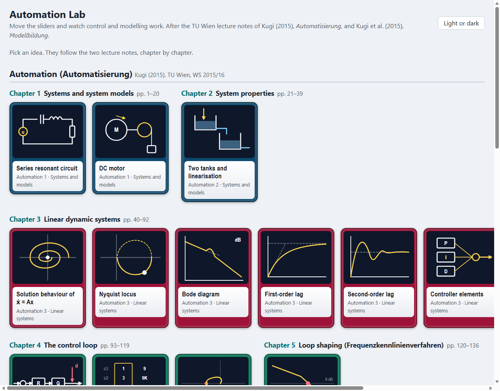
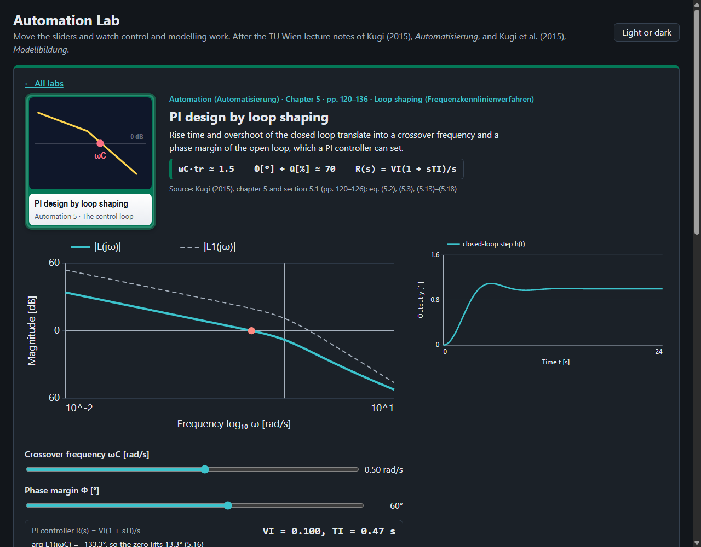
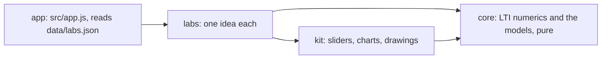

# Automation Lab

Thirty-three key ideas of automatic control and of modelling dynamic systems to play with in the browser, each with its
equations and their numbers in the TU Wien lecture notes of Kugi (2015), *Automatisierung*, and Kugi et al. (2015),
*Modellbildung*.




## What is in it

| Course and chapter | Labs |
|---|---|
| Automation 1–2 Systems, system properties | RLC circuit, DC motor, tank and its linearisation |
| Automation 3 Linear dynamic systems | phase portrait, Nyquist locus, Bode diagram, P-T1, P-T2, PID family, dead time, pole-zero diagram |
| Automation 4–5 Control loop, loop shaping | one-degree-of-freedom loop, Routh–Hurwitz, Nyquist criterion, PI design by loop shaping |
| Automation 6 Digital control loop | sampling with zero-order hold, Tustin transformation |
| Automation 7–8 State space | reachability, pole placement, Luenberger observer |
| Modelling 2 Mechanical systems | point kinematics, collisions, energy, friction, spring-mass-damper, central motion, Euler–Lagrange (ball on beam) |
| Modelling 3 Heat transfer | radiation, plane wall, insulated pipe, fins, heating a tank, finite differences |

Each lab has a chart or animation to move, readouts worked by the core, a table of the equations behind it (derived
steps marked as derived) and practice questions with worked solutions.

## Open it

Published at <https://abdulhamid-baghdadi.github.io/automation-lab/>. Locally, serve the folder and open
<http://127.0.0.1:8767/>:

```bash
python -m http.server 8767 --bind 127.0.0.1
```

Nothing is sent anywhere; the page keeps only your light or dark choice in the browser.

## How it is built



Plain JavaScript modules, no build step. Layers and their tests: [ARCHITECTURE.md](ARCHITECTURE.md). Tests:
`node --test "tests/unit/*.test.js"`.

## Limits

- A learning aid: ideal models, fixed-step Runge–Kutta integration, coarse grids.
- Where the notes give no numbers (DC motor, tanks, several presets), the labs use example values, labelled as such.
- A few equations were garbled in the PDFs' text and were re-derived; steps not in the notes have no equation number.
- No animation recorded for this README yet.
- Practice answers are worked by hand, not taken from the courses' exercise collections.
