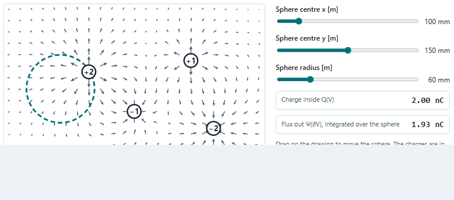
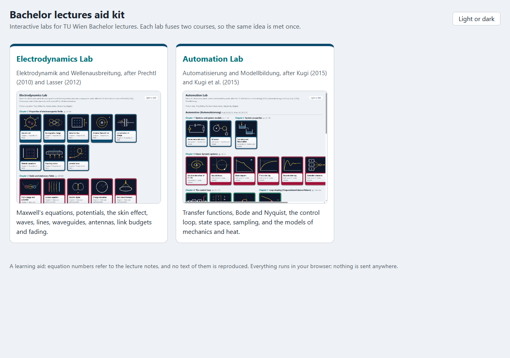
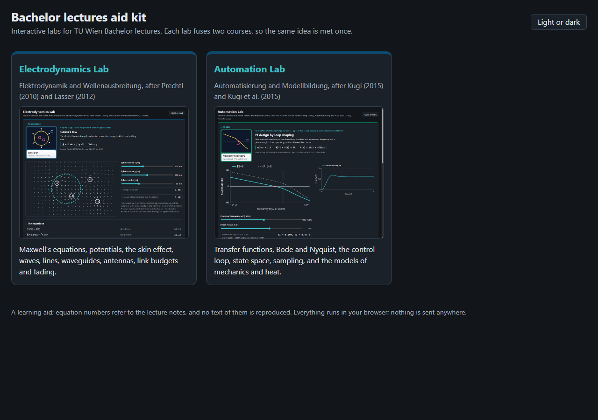
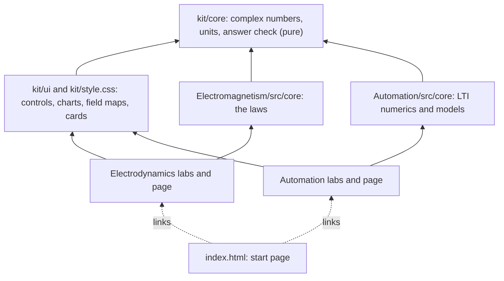

# Bachelor lectures aid kit

Interactive labs for TU Wien Bachelor lectures, each fusing two courses, where you move a slider and watch the
lecture notes' own equations work.

<picture>
  <source media="(prefers-color-scheme: dark)" srcset="Electromagnetism/docs/gauss-dark.gif">
  
</picture>

The main task in every lab, recorded from the Electrodynamics Lab: move a control, watch the field and the numbers agree.

| Light | Dark |
|---|---|
|  |  |

## The labs

| Lab | Fuses | After |
|---|---|---|
| [Electrodynamics](Electromagnetism/README.md) | Elektrodynamik, Wellenausbreitung | Prechtl (2010); Lasser (2012) |
| [Automation](Automation/README.md) | Automatisierung, Modellbildung | Kugi (2015); Kugi et al. (2015) |

Signals and systems (SS1 and SS2) is being built and joins later (`PLAN.md`).

## How to open it

Serve the folder and open the start page, for example:

```bash
python -m http.server 8771 --bind 127.0.0.1
```

then <http://127.0.0.1:8771/>. The labs are ES modules, so opening `index.html` straight from the disk does not work.
Tests, per folder: `node --test` in `kit`, `Electromagnetism` and `Automation`.

## Where your data stays

Everything runs in your browser. Nothing is sent anywhere; the only thing kept is your light or dark choice, in the
browser's local storage.

## Parts



Arrows point from a part to what it uses. The kit is shared once; each lab imports it by relative path (`../kit/...`),
with no build step. `kit/scripts/check-architecture.js` holds each lab to these layers (its `architecture.json`).

## Limits

- A learning aid: ideal models, typical material values, numerical methods on coarse grids. Equation numbers refer to
  the lecture notes; no text of them is reproduced.
- Each lab still has its own tests and its own `package.json`; there is no single test command at the root yet.
- The README pictures are recorded per lab; the start page's screenshots by headless Edge
  (`--blink-settings=preferredColorScheme=1` or `0`, window 1280 × 900).
