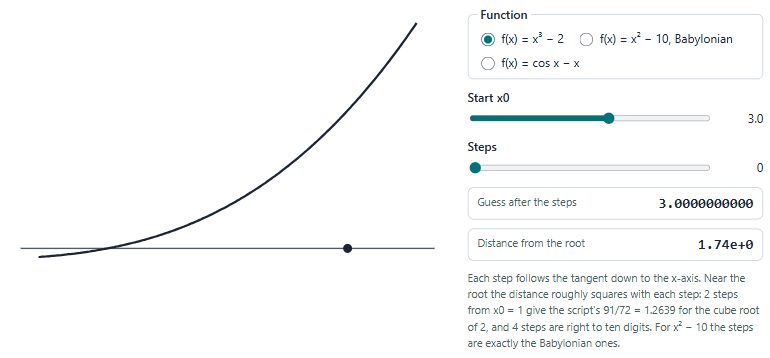
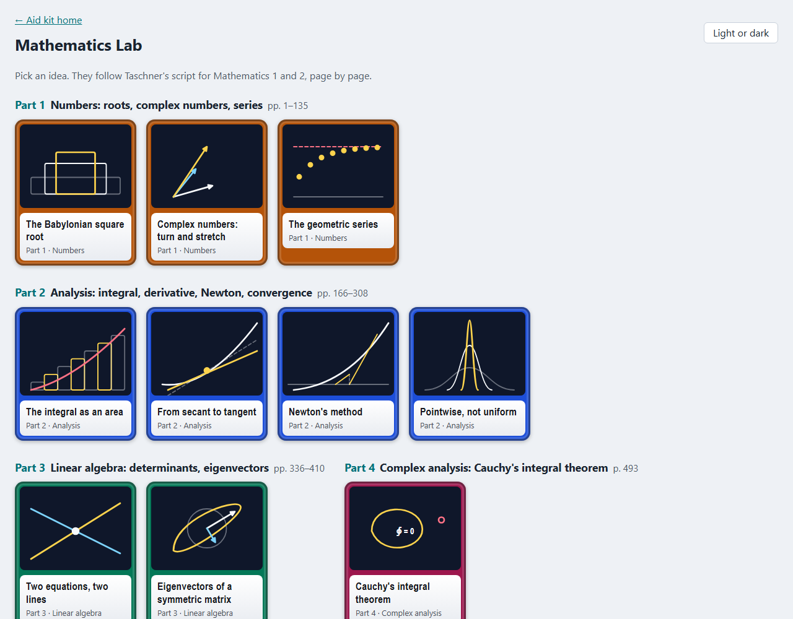
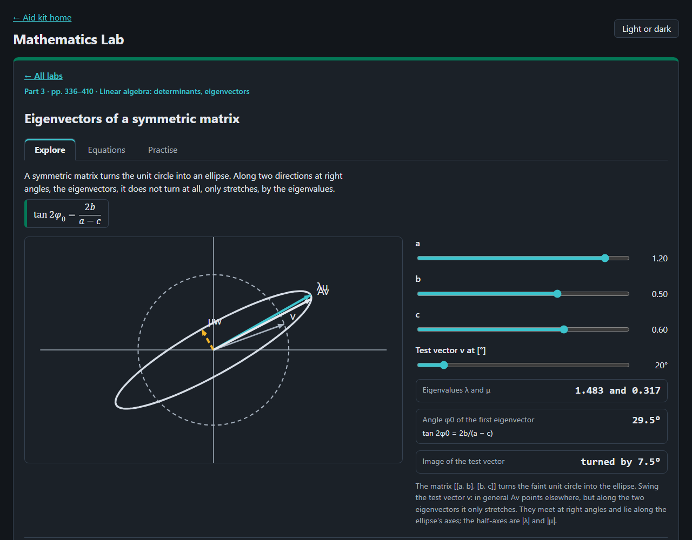
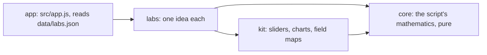

# Mathematics Lab

Ten ideas of Mathematics 1 and 2 to play with in the browser, from the Babylonian square root to Cauchy's integral
theorem, after Taschner (2013), the script of TU Wien's Mathematik 1 und 2 for electrical engineering.

<picture>
  <source media="(prefers-color-scheme: dark)" srcset="docs/newton-dark.gif">
  
</picture>

## What is in it

| Taschner (2013) | Labs |
|---|---|
| Numbers, pp. 1–135 | the Babylonian square root, complex numbers as turn and stretch, the geometric series |
| Analysis, pp. 166–308 | the integral as an area (lower and upper sums), secant to tangent, Newton's method, pointwise against uniform convergence |
| Linear algebra, pp. 336–410 | two equations as two lines (determinants, Cramer's rule), eigenvectors of a symmetric matrix |
| Complex analysis, p. 493 | Cauchy's integral theorem |

Each lab has a drawing to move, readouts worked by the core, the equations behind it with their printed page in the
script, and a practice question: the script's own worked value where it gives one, otherwise worked by hand.
Laplace transforms and linear differential equations are in the [Automation Lab](../Automation/), Fourier series in the
[Signals and Systems Lab](../signals-systems-lab/), vector analysis in the [Vector Calculus Lab](../vector-calculus-lab/).




## Open it

Serve the repository's root (the lab uses `../kit`) and open <http://127.0.0.1:8776/mathematics-lab/>:

```bash
python -m http.server 8776 --bind 127.0.0.1 --directory ..
```

Nothing is sent anywhere; the page keeps only your light or dark choice in the browser.

## How it is built



Plain JavaScript modules, no build step. Layers and their tests: [ARCHITECTURE.md](ARCHITECTURE.md). Tests:
`node --test "tests/unit/*.test.js"`.

## Limits

- The script is undated; 2013 is its PDF's creation date. Its text layer is scrambled, so every formula was read from
  the rendered pages.
- The script has no exercises: practice questions use its worked values or are worked by hand, and say which.
- Ten ideas out of 505 pages: much of the script (logarithms, curves, implicit functions, vector spaces, differential
  equations) has no lab yet.
