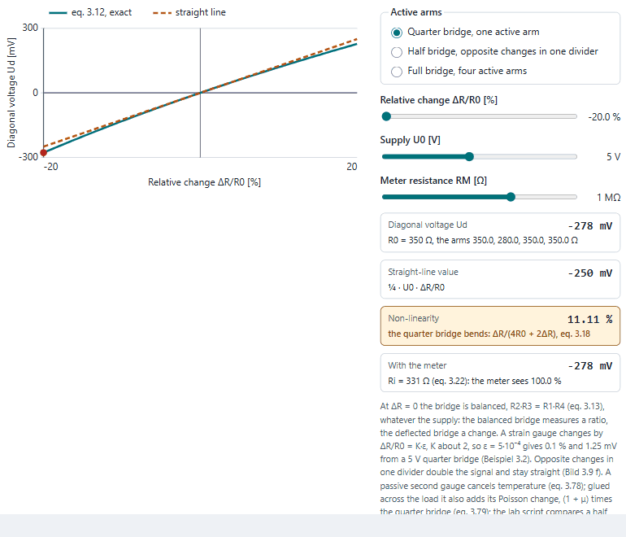
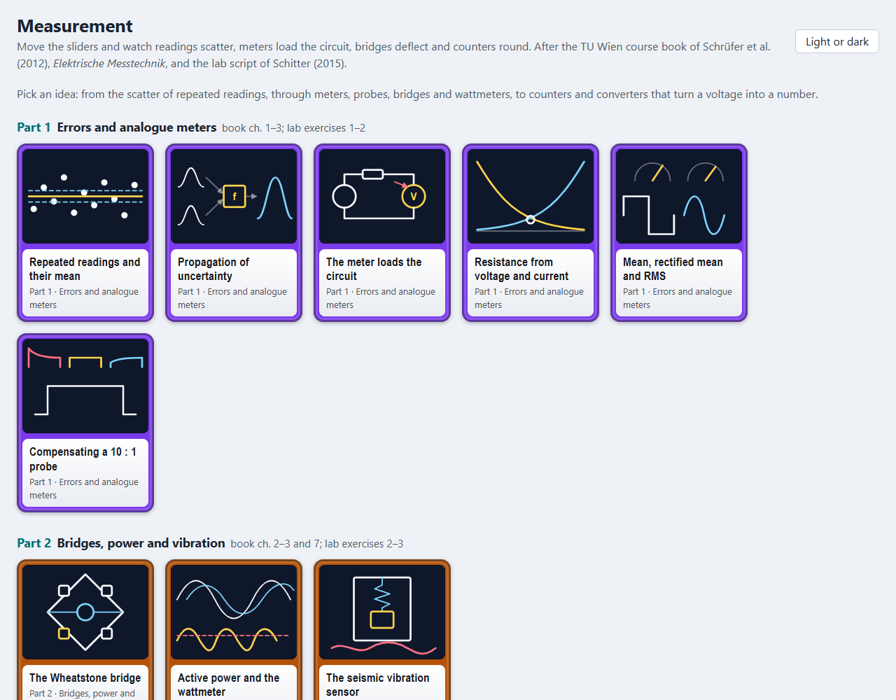
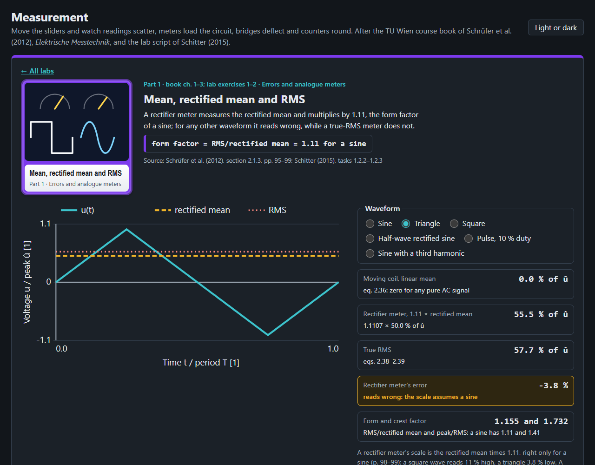
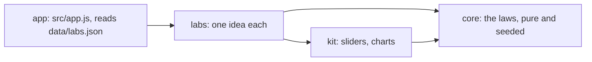

# Measurement

Twelve ideas of electrical measurement to play with in the browser, from the scatter of repeated readings to the
quantisation noise of a converter, after the TU Wien course book of Schrüfer et al. (2012), *Elektrische Messtechnik*,
and the Messtechnik-Labor script of Schitter (2015).

<picture>
  <source media="(prefers-color-scheme: dark)" srcset="docs/bridge-dark.gif">
  
</picture>

## What is in it

| Part | Labs |
|---|---|
| 1 Errors and analogue meters | repeated readings and Student's t, propagation of uncertainty (Gauss against a seeded Monte Carlo), the meter loading the circuit, resistance from voltage and current, mean, rectified mean and RMS, compensating a 10 : 1 probe |
| 2 Bridges, power and vibration | the Wheatstone bridge (quarter, half and full), active power and the wattmeter's connection, the seismic vibration sensor |
| 3 Digital measurement | counting frequency and period (±1 count), flash, successive-approximation and dual-slope converters, resolution and quantisation noise |

Each lab has charts to move, readouts worked by the core, a table of its equations with the book's equation number
and printed page, and practice questions: the book's own worked examples (Beispiele 1.2, 1.3, 1.4, 2.1, 3.2 and
Table 5.8) where there are some, otherwise worked by hand and marked so. Readings come from seeded generators, so
every visit shows the same scatter.




## Open it

Published at <https://abdulhamid-baghdadi.github.io/bachelor-lectures-aid-kit/measurement-lab/> once released.
Locally, serve the repository's root (the lab uses `../kit`) and open <http://127.0.0.1:8773/measurement-lab/>:

```bash
python -m http.server 8773 --bind 127.0.0.1 --directory ..
```

Nothing is sent anywhere; the page keeps only your light or dark choice in the browser.

## How it is built



Plain JavaScript modules, no build step. Layers and their tests: [ARCHITECTURE.md](ARCHITECTURE.md). Tests:
`node --test "tests/unit/*.test.js"`.

## Limits

- A learning aid: ideal sources, resistive meters, normal readings, and ideal comparators and integrators unless a
  lab says otherwise.
- Not yet in a lab: measuring amplifiers and the instrumentation amplifier (lab exercise 3.2), AC bridges, inductive
  and capacitive sensors, the u/f converter and delta-sigma converters, oscilloscope triggering, signal transmission
  and reflections (lab exercise 4), sampling (lab exercise 5) and sensors (lab exercise 6).
- The lab script has tasks but no worked solutions, and no exam with solutions was at hand: practice questions are the
  book's worked examples or were worked by hand.
- Spectrum analysis (the DFT, windows) is the Signals and Systems lab's; three-phase power and the two-wattmeter
  method the Power engineering lab's; Bode plots the Automation lab's; PCM the Telecommunications lab's.
