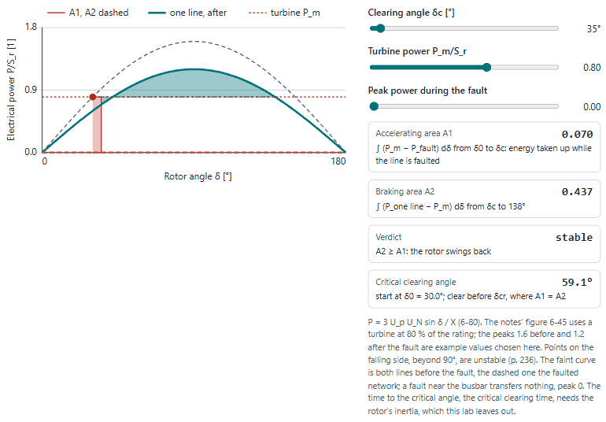
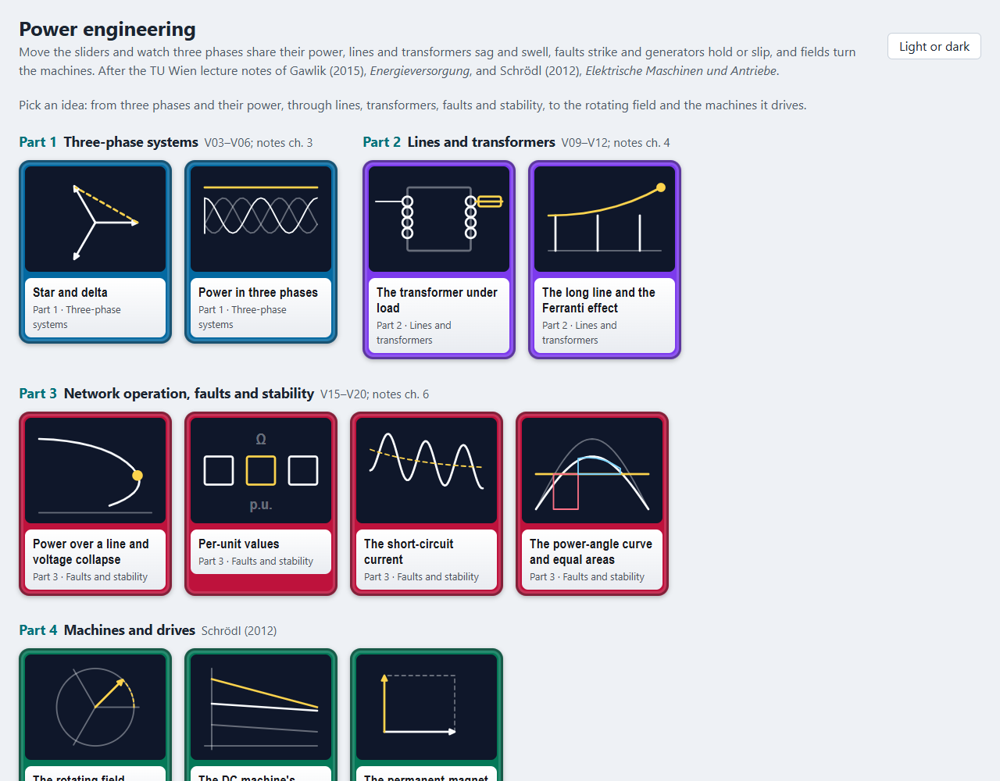
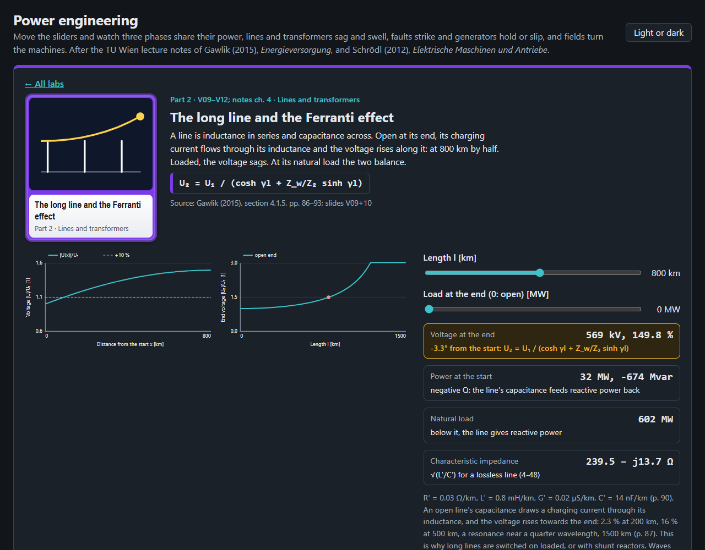
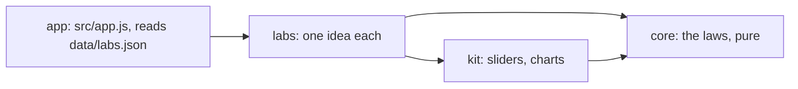

# Power engineering

Eleven ideas of power systems and electrical machines to play with in the browser, from star and delta to the
permanent-magnet synchronous machine, after the TU Wien lecture notes of Gawlik (2015), *Energieversorgung*, and
Schrödl (2012), *Elektrische Maschinen und Antriebe*.

<picture>
  <source media="(prefers-color-scheme: dark)" srcset="docs/stability-dark.gif">
  
</picture>

## What is in it

| Part | Labs |
|---|---|
| 1 Three-phase systems | star and delta, active, reactive and apparent power in three phases |
| 2 Lines and transformers | the transformer under load, the long line and the Ferranti effect |
| 3 Network operation, faults and stability | power over a line and voltage collapse, per-unit values, the short-circuit current and κ, the power-angle curve and equal areas |
| 4 Machines and drives | the rotating field, the DC machine's characteristics, the permanent-magnet synchronous machine |

Each lab has charts or phasor diagrams to move, readouts worked by the core, a table of its equations with the
equation number and page they come from, and practice questions: the notes' own worked examples and two machines exams
where there are some, otherwise worked by hand and marked so.




## Open it

Published at <https://abdulhamid-baghdadi.github.io/bachelor-lectures-aid-kit/power-engineering-lab/> once released.
Locally, serve the repository's root (the lab uses `../kit`) and open <http://127.0.0.1:8774/power-engineering-lab/>:

```bash
python -m http.server 8774 --bind 127.0.0.1 --directory ..
```

Nothing is sent anywhere; the page keeps only your light or dark choice in the browser.

## How it is built



Plain JavaScript modules, no build step. Layers and their tests: [ARCHITECTURE.md](ARCHITECTURE.md). Tests:
`node --test "tests/unit/*.test.js"`.

## Limits

- A learning aid: symmetric systems in the steady state, lumped models, and per-unit example values where a lab says
  so (the stability lab's curve peaks, the PMSM's r_s and l_s).
- No induction-machine equivalent circuit or Kloss torque curve, and no V-curves of the wound-rotor synchronous
  machine: neither source treats them (the notes give only the slip, Schrödl's text covers the DC machine, windings and
  the PMSM). Symmetrical components and unbalanced faults, load-flow methods, frequency control and the economics part
  are in the notes but not yet in a lab. The critical clearing time needs the rotor's inertia, which the notes do not
  give.
- Schrödl (2012) is a scan whose text layer drops the equations: they were read from the page images. The notes'
  formulas are scrambled in their text layer: each was matched to its equation number, and where a
  printed equation disagreed with the next ((4-77) against (4-80)) the lab says so.
- Phasor arithmetic, Bode plots and control loops are the Automation lab's; harmonics and distortion power the Signals
  and Systems lab's; waves on lines the Electrodynamics lab's.
