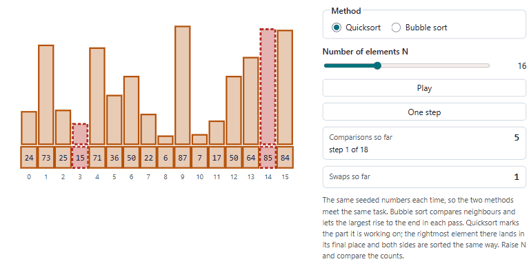
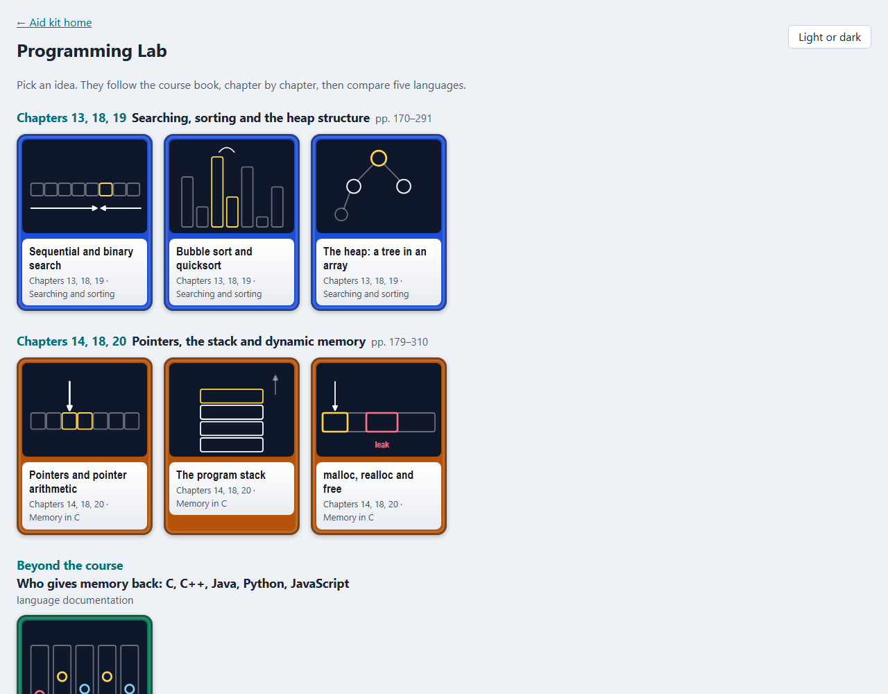
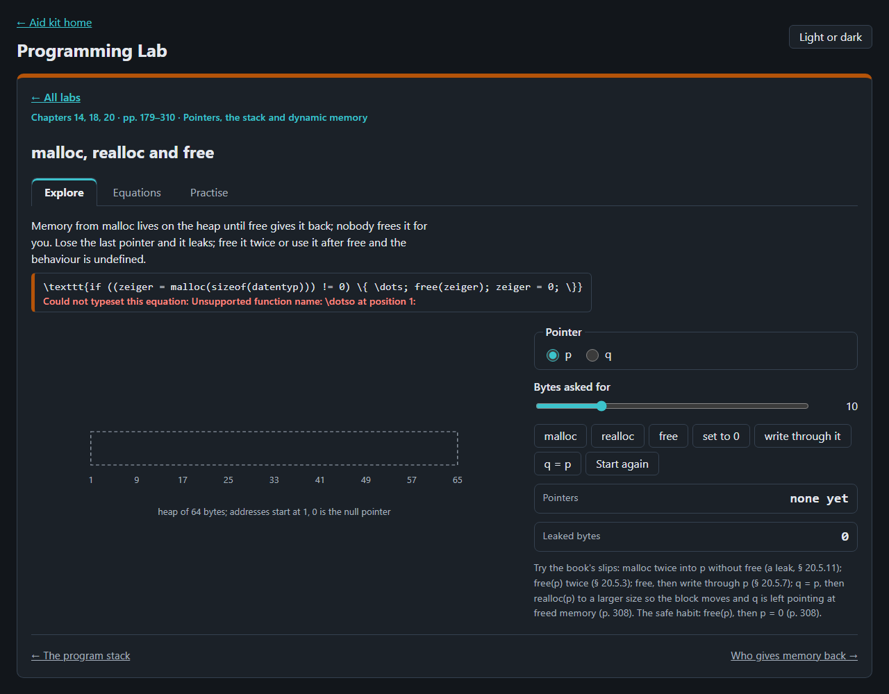
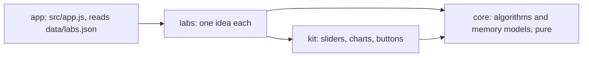

# Programming Lab

Programming in C to play with in the browser, searching, sorting, heaps, pointers, the stack, malloc and free, and
how five languages give memory back, after Klima and Selberherr (2010), *Programmieren in C*, the course book of TU
Wien's Programmieren 1 and 2.

<picture>
  <source media="(prefers-color-scheme: dark)" srcset="docs/sorting-dark.gif">
  
</picture>

## What is in it

| Source | Labs |
|---|---|
| Klima and Selberherr (2010), ch. 13, 18, 19 | sequential and binary search, bubble sort and quicksort, the heap as a tree in an array |
| Klima and Selberherr (2010), ch. 14, 18, 20 | pointers and pointer arithmetic, the program stack, malloc, realloc and free with their typical errors |
| The languages' own documentation | who gives memory back: C, C++, Java, Python and JavaScript in the same three situations |

Each lab has a drawing to drive, readouts worked by the core, the rules behind it with their page in the book, and a
practice question, the book's own worked example where it gives one. The slides of Ceric et al. (2015) follow the
book chapter by chapter.




## Open it

Serve the repository's root (the lab uses `../kit`) and open <http://127.0.0.1:8777/programming-lab/>:

```bash
python -m http.server 8777 --bind 127.0.0.1 --directory ..
```

Nothing is sent anywhere; the page keeps only your light or dark choice in the browser.

## How it is built



Plain JavaScript modules, no build step. Layers and their tests: [ARCHITECTURE.md](ARCHITECTURE.md). Tests:
`node --test "tests/unit/*.test.js"`.

## Sources for the comparison of languages

Read on 2 Nov 2026; each rule in the lab is quoted from these.

- C: Klima and Selberherr (2010), ch. 20; cppreference, [free](https://en.cppreference.com/w/c/memory/free) (citing C17 § 7.22.3.3).
- C++: cppreference, [std::unique_ptr](https://en.cppreference.com/w/cpp/memory/unique_ptr).
- Java: The Java Virtual Machine Specification, Java SE 21 Edition, [§ 2.5.2–2.5.3](https://docs.oracle.com/javase/specs/jvms/se21/html/jvms-2.html).
- Python: The Python Language Reference, [§ 3.1 Objects, values and types](https://docs.python.org/3/reference/datamodel.html); Python/C API, [Memory Management](https://docs.python.org/3/c-api/memory.html).
- JavaScript: MDN Web Docs, [Memory management](https://developer.mozilla.org/en-US/docs/Web/JavaScript/Guide/Memory_management).

## Limits

- The malloc lab is a model: a 64-byte heap, first fit, blocks rounded up to 8 bytes as the book says many systems
  do. Real allocators differ, and real errors are undefined behaviour, not tidy messages.
- The comparison keeps to the rules its sources state. It leaves out C++'s shared_ptr, Java's and JavaScript's
  generational collectors and Python implementations other than CPython.
- The question catalogues of the course have no worked answers, so practice uses the book's examples or is worked by
  hand.
