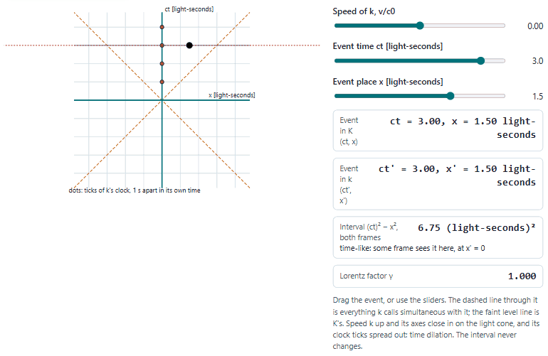
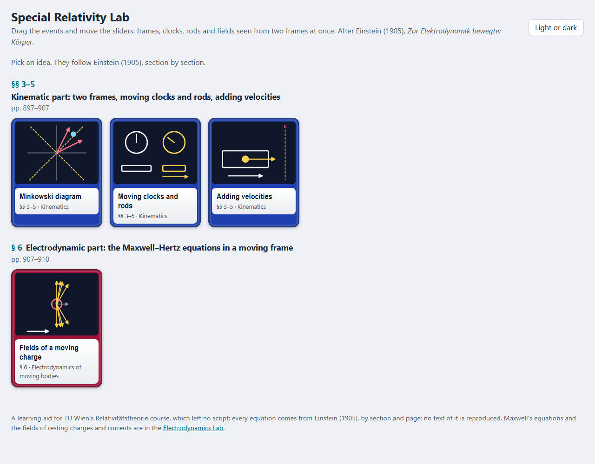
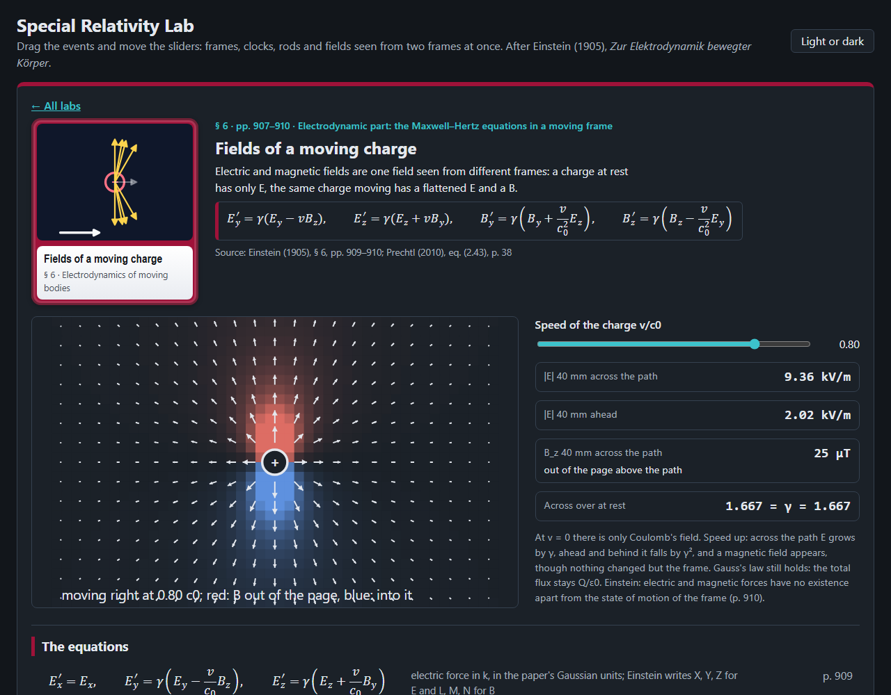
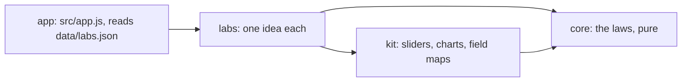

# Special Relativity Lab

Five ideas of relativity to play with in the browser: frames, clocks, rods and fields seen from two frames at once,
after Einstein (1905), *Zur Elektrodynamik bewegter Körper*, and free fall seen from a falling frame, after Einstein
(1916), *Die Grundlage der allgemeinen Relativitätstheorie*, for TU Wien's Relativitätstheorie course.

<picture>
  <source media="(prefers-color-scheme: dark)" srcset="docs/minkowski-dark.gif">
  
</picture>

## What is in it

| Source | Labs |
|---|---|
| Einstein (1905) §§ 3–5 Kinematic part | Minkowski diagram (simultaneity and the interval), moving clocks and rods, adding velocities |
| Einstein (1905) § 6 Electrodynamic part | the fields of a moving charge: E and B mixing under a boost |
| Einstein (1916) §§ 2, 21–22 Gravitation | free fall: a thrown ball goes straight in the falling frame and bends into an arch on the ground; only g44, the rate of clocks, enters |

Each lab has a drawing to move, readouts worked by the core, a table of the equations behind it with their page in
Einstein (1905) or (1916), and a practice question worked by hand. Maxwell's equations and the fields of resting charges are in
the [Electrodynamics Lab](../Electromagnetism/).




## Open it

Serve the repository's root (the lab uses `../kit`) and open <http://127.0.0.1:8772/relativity-lab/>:

```bash
python -m http.server 8772 --bind 127.0.0.1 --directory ..
```

Nothing is sent anywhere; the page keeps only your light or dark choice in the browser.

## How it is built



Plain JavaScript modules, no build step. Layers and their tests: [ARCHITECTURE.md](ARCHITECTURE.md). Tests:
`node --test "tests/unit/*.test.js"`.

## Limits

- A learning aid in one dimension of motion: every boost is along x.
- Gravitation only in the Newtonian limit of a uniform field (Einstein 1916, § 21): no tides, no orbits, no field
  equations.
- The course left no script and no exercises: every equation is from Einstein (1905) or (1916), checked against the
  scanned originals, and the practice answers are worked by hand.
- Einstein's field equations use Gaussian units; the SI form shown beside them is derived and marked so.
