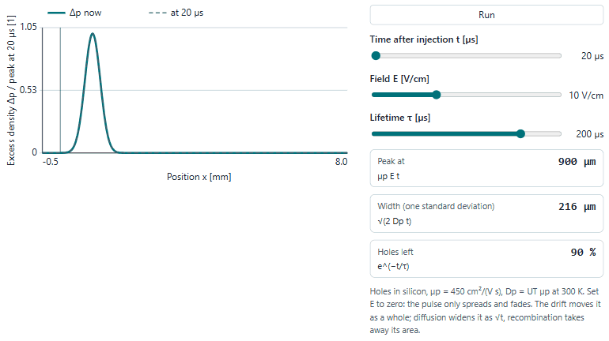
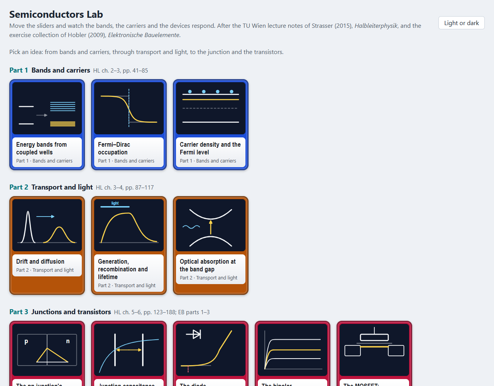
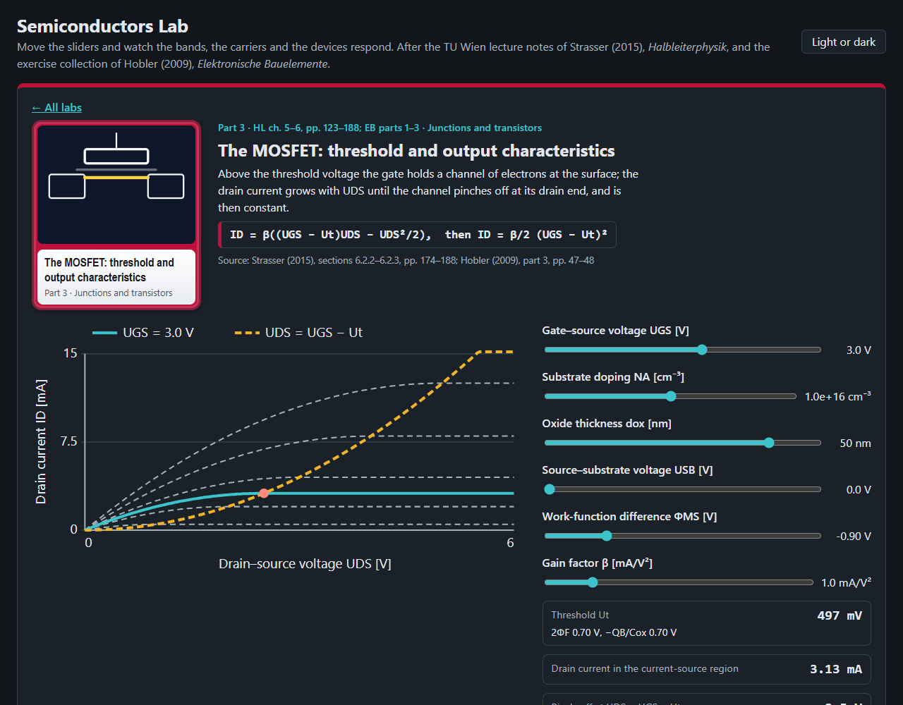
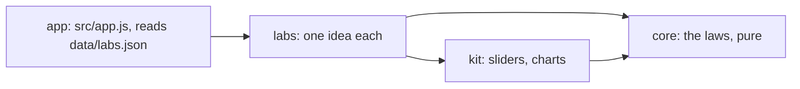

# Semiconductors Lab

Eleven ideas of semiconductor physics and devices to play with in the browser, from energy bands to the MOSFET, after
Strasser (2015), *Skriptum Halbleiterphysik*, and the exercise collection of Hobler (2009), *Elektronische
Bauelemente*, the texts of two TU Wien courses.

<picture>
  <source media="(prefers-color-scheme: dark)" srcset="docs/drift-dark.gif">
  
</picture>

## What is in it

| Part | Labs |
|---|---|
| 1 Bands and carriers | energy bands from coupled wells (Kronig–Penney), Fermi–Dirac occupation, carrier density and the Fermi level against temperature and doping |
| 2 Transport and light | drift and diffusion (the Shockley–Haynes pulse), generation, recombination and lifetime, optical absorption and gain at the band gap |
| 3 Junctions and transistors | the pn junction's space-charge zone, junction capacitance, the diode characteristic, the bipolar transistor's output characteristics, the MOSFET's threshold and output characteristics |

Each lab has charts to move, readouts worked by the core, a table of the equations behind it with their section, page
and equation number in the script, and practice questions from the two courses' exercise sheets. Silicon at 300 K
unless a lab says otherwise, with the data of the script's table (p. 73).




## Open it

Published at <https://abdulhamid-baghdadi.github.io/bachelor-lectures-aid-kit/semiconductors-lab/> once released.
Locally, serve the repository's root (the lab uses `../kit`) and open <http://127.0.0.1:8769/semiconductors-lab/>:

```bash
python -m http.server 8769 --bind 127.0.0.1 --directory ..
```

Nothing is sent anywhere; the page keeps only your light or dark choice in the browser.

## How it is built



Plain JavaScript modules, no build step. Layers and their tests: [ARCHITECTURE.md](ARCHITECTURE.md). Tests:
`node --test "tests/unit/*.test.js"`.

## Limits

- A learning aid. All dopants are ionised (no freeze-out), the band gap is held at its 300 K value, junctions use the
  depletion approximation, and the diode's breakdown is only marked, not drawn.
- The Early effect and channel-length modulation are left out, so the transistors' output curves are flat.
- Absorption is relative (the script gives no cross-section) and drawn for direct GaAs only.
- Most practice answers are worked by hand from the script; two agree with the Bauelemente course's scanned worked
  solutions. The Halbleiterphysik solutions are scans not read here.
