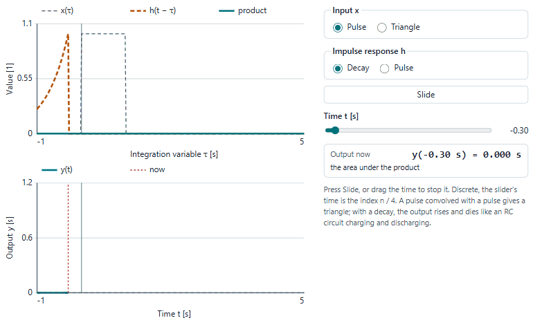
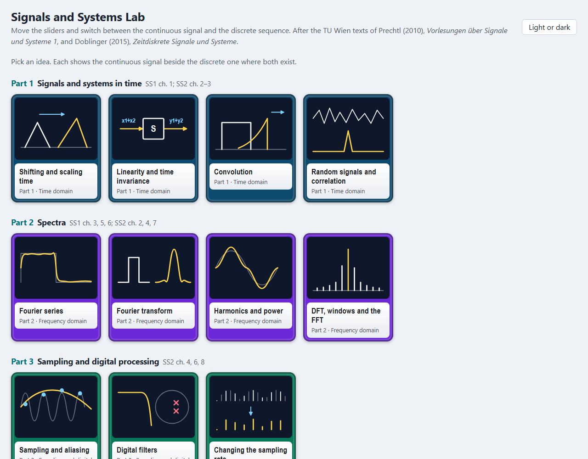
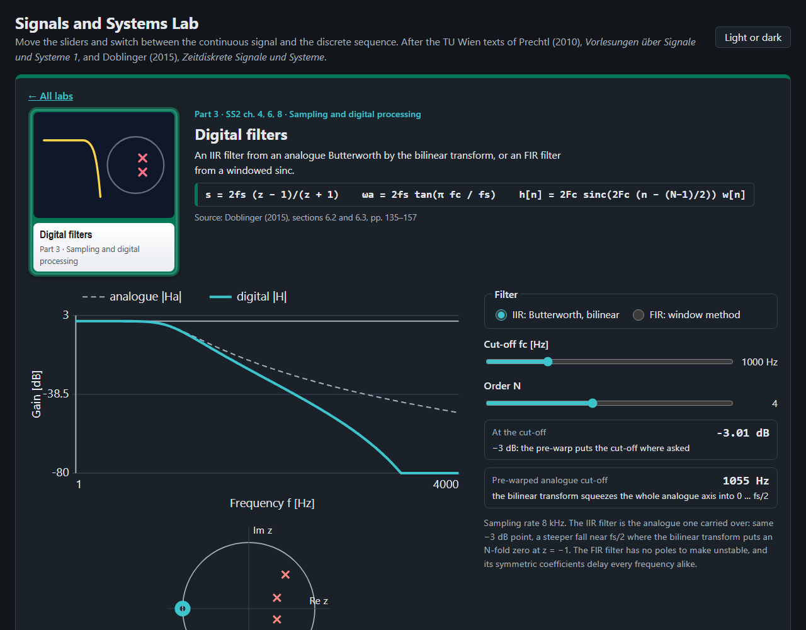
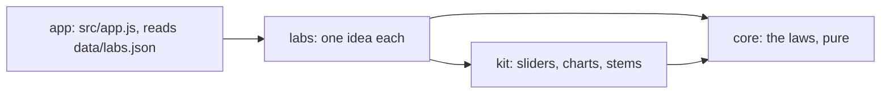

# Signals and Systems Lab

Eleven ideas of signals and systems to play with in the browser, the continuous signal beside the discrete sequence,
after Prechtl (2010), *Vorlesungen über Signale und Systeme 1*, and Doblinger (2015), *Zeitdiskrete Signale und
Systeme*, the texts of TU Wien's Signals and systems 1 and 2.

<picture>
  <source media="(prefers-color-scheme: dark)" srcset="docs/convolution-dark.gif">
  
</picture>

## What is in it

| Part | Labs |
|---|---|
| 1 Signals and systems in time | shifting and scaling time, linearity and time invariance, convolution, random signals and correlation |
| 2 Spectra | Fourier series, Fourier transform, harmonics and power, DFT, windows and the FFT |
| 3 Sampling and digital processing | sampling and aliasing, digital filters (Butterworth by the bilinear transform, FIR by windows), changing the sampling rate |

Each lab has charts to move, readouts worked by the core, a table of the equations behind it with their section in
either text, and a practice question. Where both exist, a switch shows the same idea for a continuous signal and for a
sequence; a sequence is always drawn as stems with dots. Laplace and z-transform, Bode diagrams and the state space are
in the Automation Lab.




## Open it

Published at <https://abdulhamid-baghdadi.github.io/bachelor-lectures-aid-kit/signals-systems-lab/>. Locally, serve the
repository's root (the lab uses `../kit`) and open <http://127.0.0.1:8768/signals-systems-lab/>:

```bash
python -m http.server 8768 --bind 127.0.0.1 --directory ..
```

Nothing is sent anywhere; the page keeps only your light or dark choice in the browser.

## How it is built



Plain JavaScript modules, no build step. Layers and their tests: [ARCHITECTURE.md](ARCHITECTURE.md). Tests:
`node --test "tests/unit/*.test.js"`.

## Limits

- A learning aid. Integrals are sums on fixed grids; the noise is seeded, so every visit shows the same samples.
- Practice answers are worked by hand; the courses' exercise collections are not used yet.
- Equation references give the section of each text, not its equation number; no text of either is reproduced.
