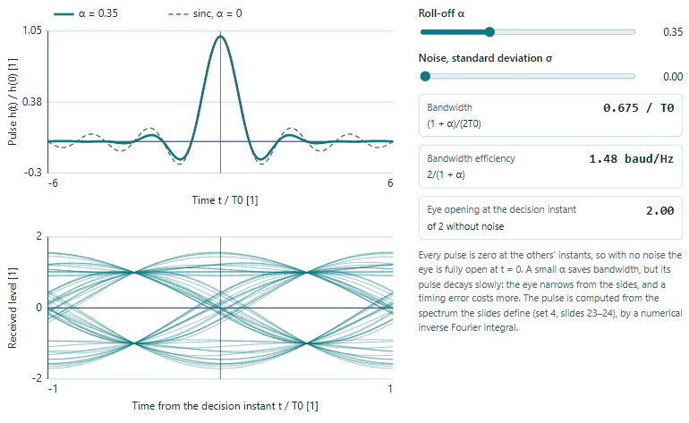
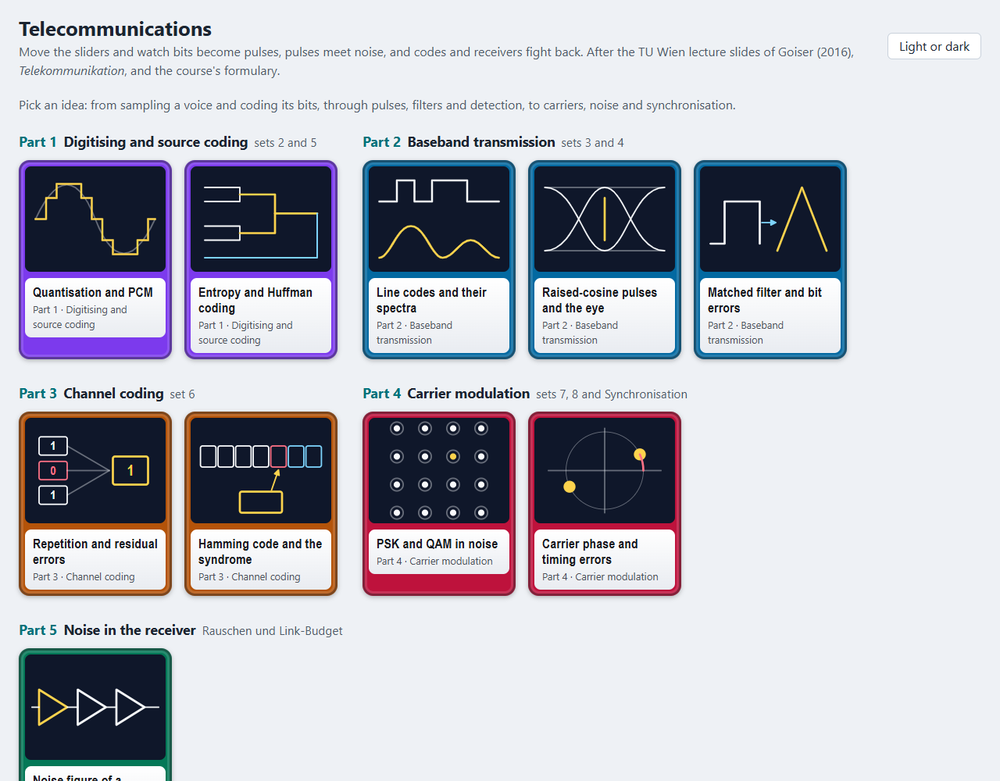
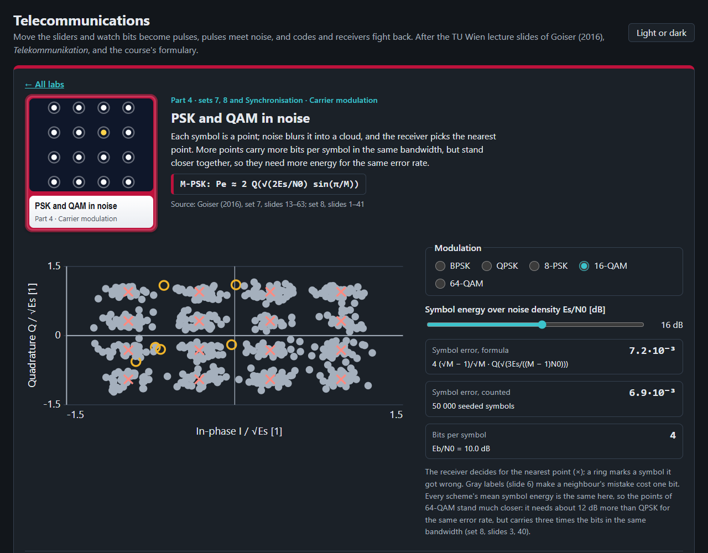
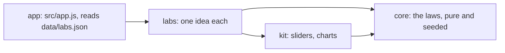

# Telecommunications

Ten ideas of digital telecommunication to play with in the browser, from quantising a sample to the noise figure of
a receiver, after the TU Wien lecture slides of Goiser (2016), *Telekommunikation*, and the course formulary.

<picture>
  <source media="(prefers-color-scheme: dark)" srcset="docs/eye-dark.gif">
  
</picture>

## What is in it

| Part | Labs |
|---|---|
| 1 Digitising and source coding | quantisation and PCM (6 dB a bit, and bit errors after decoding), entropy and Huffman coding |
| 2 Baseband transmission | line codes and their spectra, raised-cosine pulses and the eye diagram, the matched filter and the bit error probability |
| 3 Channel coding | repetition codes and residual errors, the [7,4] Hamming code and its syndrome |
| 4 Carrier modulation | PSK and QAM constellations in seeded noise, carrier-phase and timing errors |
| 5 Noise in the receiver | the noise figure of a chain by Friis's formula |

Each lab has charts to move, readouts worked by the core, a table of its equations with the lecture set and slide
number they come from, and practice questions: the slides' own worked examples where there are some, otherwise worked
by hand and marked so. Noise comes from seeded generators, so every visit shows the same cloud, eye and count.




## Open it

Published at <https://abdulhamid-baghdadi.github.io/bachelor-lectures-aid-kit/telecommunications-lab/> once released.
Locally, serve the repository's root (the lab uses `../kit`) and open <http://127.0.0.1:8772/telecommunications-lab/>:

```bash
python -m http.server 8772 --bind 127.0.0.1 --directory ..
```

Nothing is sent anywhere; the page keeps only your light or dark choice in the browser.

## How it is built



Plain JavaScript modules, no build step. Layers and their tests: [ARCHITECTURE.md](ARCHITECTURE.md). Tests:
`node --test "tests/unit/*.test.js"`.

## Limits

- A learning aid: white Gaussian noise, binary or square constellations, hard decisions, and perfect synchronisation
  outside the synchronisation lab.
- AM and FM are left out: none of the 2016 slide sets treats them. Duobinary signalling, convolutional codes and
  Viterbi decoding, CRC, MSK, OFDM, spread spectrum and CDMA are in the slides but not yet in a lab.
- The slides' text layer garbles some formulas (M-PSK and M-QAM error rates, the raised cosine's closed form). Each was
  read with care and checked against a seeded simulation; the raised-cosine pulse is computed from the spectrum the
  slides define rather than from a remembered formula.
- No exercise collection or exam with worked solutions was at hand: practice questions are the slides' worked examples
  or were worked by hand.
- Sampling, the Fourier transform and filters are the Signals and Systems lab's; free-space link budgets, fading and
  delay spread the Electrodynamics lab's.
