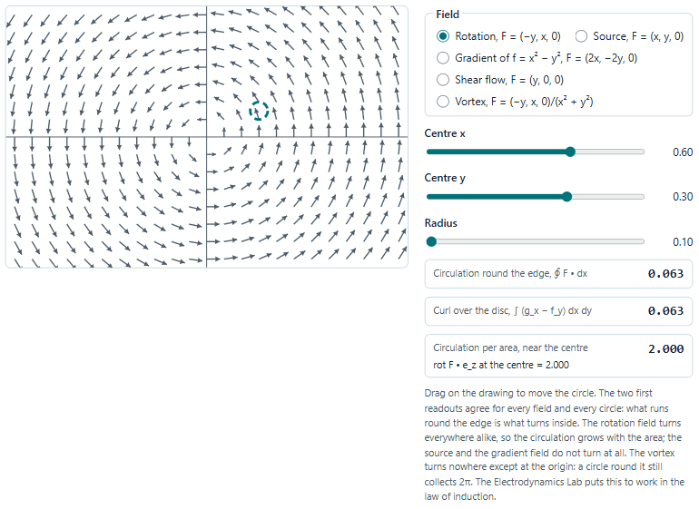
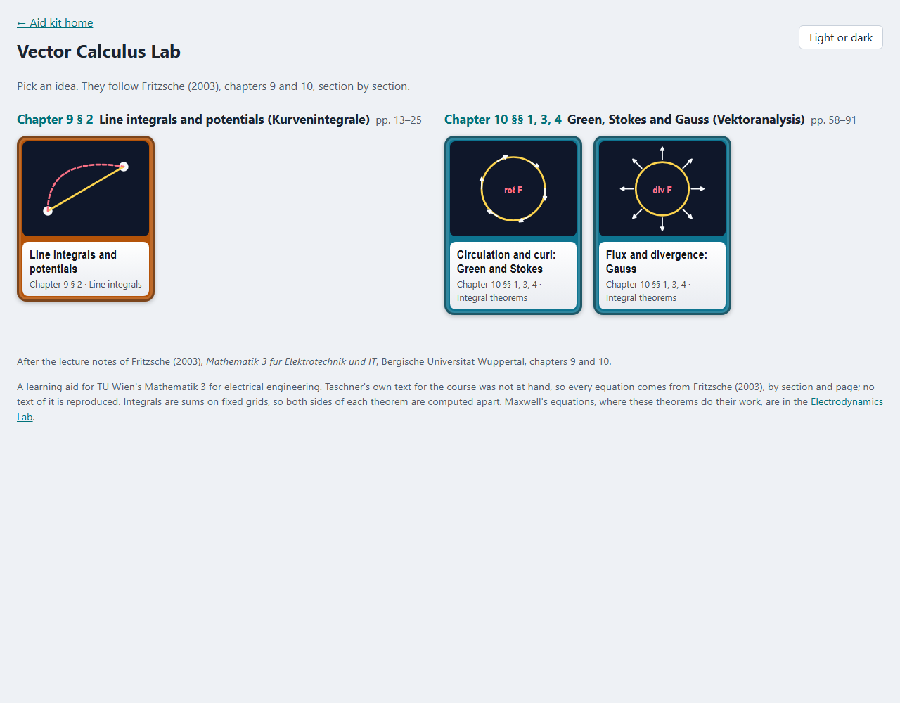
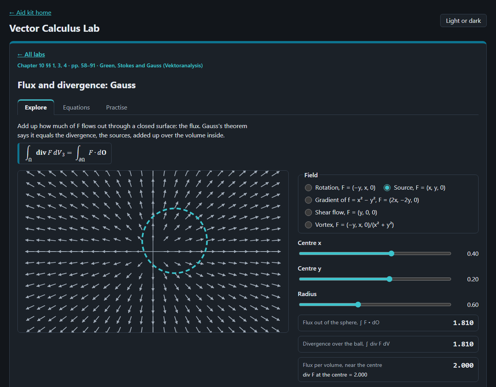
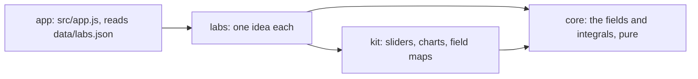

# Vector Calculus Lab

The integral theorems of vector analysis to play with in the browser, line integrals, circulation and curl, flux and
divergence, after Fritzsche (2003), *Mathematik 3 für Elektrotechnik und IT*, for TU Wien's Mathematik 3 for
electrical engineering.

<picture>
  <source media="(prefers-color-scheme: dark)" srcset="docs/stokes-dark.gif">
  
</picture>

## What is in it

| Fritzsche (2003) | Labs |
|---|---|
| ch. 9 § 2 Line integrals | line integrals and potentials: two paths from p to q, path independence, the vortex |
| ch. 10 §§ 1, 3, 4 Vector analysis | circulation and curl (Green and Stokes), flux and divergence (Gauss) |

Each lab has a field to move a path, circle or sphere through, the two sides of its theorem computed apart, a table of
the equations behind it with their page in Fritzsche (2003), and practice questions. Maxwell's equations, where these
theorems do their work, are in the [Electrodynamics Lab](../Electromagnetism/).




## Open it

Serve the repository's root (the lab uses `../kit`) and open <http://127.0.0.1:8775/vector-calculus-lab/>:

```bash
python -m http.server 8775 --bind 127.0.0.1 --directory ..
```

Nothing is sent anywhere; the page keeps only your light or dark choice in the browser.

## How it is built



Plain JavaScript modules, no build step. Layers and their tests: [ARCHITECTURE.md](ARCHITECTURE.md). Tests:
`node --test "tests/unit/*.test.js"`.

## Limits

- Taschner's own text for the TU Wien course, *Anwendungsorientierte Mathematik*, Band 3 (Hanser), was not at hand;
  the course's exam questions also ask for differential forms and the wedge product, which these labs leave out.
- Fields lie in the plane or do not depend on z, so the drawings stay flat; the sphere of the Gauss lab is shown where
  it cuts the plane z = 0.
- Every integral is a sum on a fixed grid: the two sides of a theorem agree to three decimals, not exactly.
